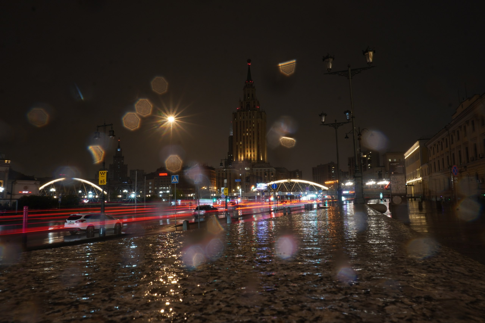
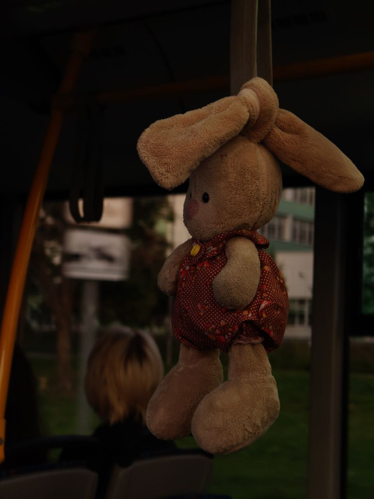
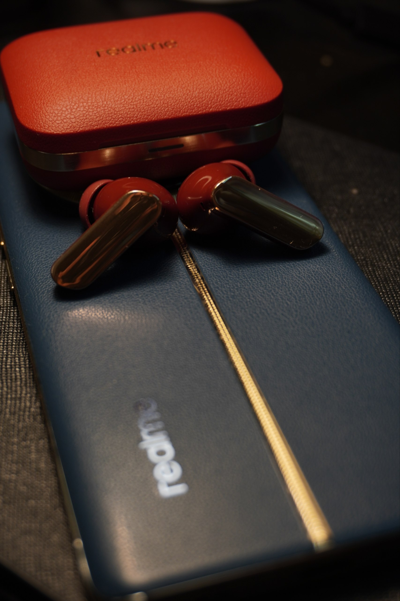

<h1 align="center">Привет, я Дима ДимаДимаДима</h1>

  Студент ИТМО (AI Engineering) · преподаватель доп. образования · разработчик · Санкт-Петербург

---

## 🔭 Чем занимаюсь

- 🎓 Учусь в ИТМО на направлении AI Engineering
- 🏫 Веду кружки по робототехнике и схемотехнике для школьников

## 🧩 Проекты

| Проект | О чём | Стек |
|---|---|---|
| **Geo-RAG для Петербурга** | Вопросы про кафе, парки и музеи в центре города. Проверяю гипотезу: обычный RAG ошибается на вопросах про расстояния, а система с геоинструментом справляется лучше | Python, Ollama, OSMnx, FAISS, GeoPandas |
| **BulTrack** | GPS-трекер прогулок | Android |
| **BulMapPlaces** (Place Diary) | Личный дневник мест на карте | Mobile |
| **BulHub** · [GitHub](https://github.com/DmitriyRybka/BulHub) | Хаб продуктивности, центр моей «Буль-экосистемы» | Full-stack |
| **Путь лицеиста** | Геймифицированное веб-приложение, помогающее школьникам адаптироваться в лицее | Web |
| **INCNUM** | AutoLISP-инструмент для AutoCAD: автонумерация блоков вдоль кабельных полилиний и сводная таблица | AutoLISP |

## 🤖 Железо и робототехника

| Проект | О чём | Внутри |
|---|---|---|
| **Фонарик для фото** | Портативный свет для съёмки с регулировкой яркости, цветовой температуры и цвета. Заодно будет будильником-рассветом. Сейчас собираю | ESP32-C3, светодиодные ленты на алюминиевой пластине, рассеиватель, 18650 с повышающим преобразователем, энкодер; своя прошивка |
| **Поворотный стол для 3D-сканирования** | Вращает объект с регулируемой скоростью для моего 3D-сканера. Портативный, работает от одного 18650 | Arduino Leonardo, шаговый мотор 28BYJ-48 |
| **Подсветка для 3D-принтера** | Белый свет и RGB-подсветка внутри FlashForge Adventurer 5M, плюс камера, чтобы следить за печатью | ESP32-C3 SuperMini, COB-лента 24 В с ШИМ через MOSFET, WS2812B на WLED, Logitech C270 в напечатанном креплении |
И ещё много всего по мелочи.

## 🛠️ Технологии

  

**Данные и ML:** pandas, NumPy, GeoPandas, Streamlit, sentence-transformers, FAISS

## 📷 Фотография

Снимаю на свою Sony a6400, на ней и научился. Прошёл курс основ творческой фотографии и фотонаправление Школы Мегабайта, сейчас пробую видео: обзоры мест и нарезки прогулок.

  
  
  

## 📫 Как связаться

Telegram: [@justfishka](https://t.me/justfishka)

Ещё веду канал [«It was just a fish»](https://t.me/ВАШ_КАНАЛ): вайбовые фотки, иногда проектики

> 🐟 Фанфакт: фамилия Рыбка
